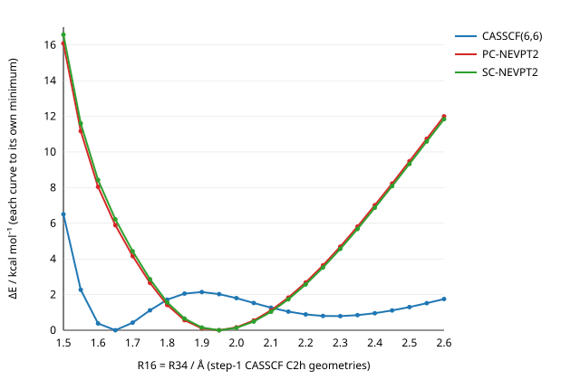

# `cope_rearrangement/step_2/`

Step 2 of the chair Cope study: **PC-NEVPT2 along step 1's relaxed C2h
CASSCF(6,6) scan, and the a_u curvature at selected points.** PySCF for
DF-CASSCF and SC-NEVPT2, block2 (`pyblock2.icmr`) for PC-NEVPT2, which PySCF
does not implement. Nothing here is built.

**State: partial.** E(R) is done at all 23 scan points. The a_u curvature was
run at two R values, not all 23 (see *What is not done*): R = 1.95 Å, the
NEVPT2 minimum, which decides the question, and R = 1.65 Å, CASSCF's diyl.

## Result in one paragraph

NEVPT2 removes CASSCF's two-region structure. Under C2h, PC-NEVPT2 E(R)
has **one minimum, at R = 1.95 Å**, where CASSCF has a 2 kcal/mol ridge
between its diyl (1.65 Å) and "aromatic" (2.30 Å) minima. At that NEVPT2
minimum, the PC-NEVPT2 a_u Hessian has a **negative eigenvalue** (−0.090
Eh/bohr² in a 3-dimensional subspace, which bounds the full block's lowest
eigenvalue from above). The C2h structure is therefore an a_u saddle, not an
intermediate: **concerted**. The hybrid estimate of the full block has exactly
one imaginary a_u frequency, 448i cm⁻¹, whose mode is 96 % along
R16 − R34.

## Method

| | |
|---|---|
| geometries | step 1's, unchanged: DF-CASSCF(6,6)/cc-pVDZ, relaxed under C2h at fixed R16 = R34 = R. **CASSCF geometries with PT2 energies**: the guide's step 4 re-optimises at PT2 |
| reference | DF-CASSCF(6,6) reconverged **in C1** from step 1's orbitals (`pt2.py` says why C1), 1e-11 Eh / 1e-6 orbital gradient; every scan point is asserted to reproduce step 1's C2h energy to 1e-7 Eh (it does, to 1e-10) |
| PC-NEVPT2 | block2's `WickICNEVPT2`, on PySCF's canonicalised orbitals and its **density-fitted** integrals (`dfnevpt2._ERIS`, cc-pVDZ-JKFIT), as in `tools/emit/nevpt2_reference.py` |
| SC-NEVPT2 | PySCF's `mrpt.NEVPT`, same integrals, on the **active natural orbitals** (SC is not invariant to active rotations; PC is) |
| a_u basis | `au.py`: the a_u projector of the C2h operations on the 48 Cartesians, rank 11; minus the translation along the C2 axis (a_u in C2h), **10 vibrational a_u coordinates**. Column 0 is s = (R16 − R34)/√2's own direction |
| CASSCF a_u Hessian | full 10 × 10, from analytic DF-CASSCF gradients at x0 + h q_j, h = 0.02 bohr. One gradient per column, because the a_u gradient is odd in an a_u displacement, so the error is a central difference's, O(h²) |
| NEVPT2 a_u Hessian | energies only, in a 3-dimensional subspace V: the CASSCF relaxed-s direction H⁻¹b, then the two softest CASSCF a_u modes. E(h v_a) and E(h (v_a + v_b)) give H_V to O(h²) (E is even in a_u) |
| checks, per R | (1) the energy-based CASSCF H_V must match the gradient-based H projected onto V; (2) E(−h v₀) must equal E(h v₀) by symmetry; (3) the a_u gradient at x0 must vanish |

**What the numbers mean.**
- `n_negative` is the count of negative eigenvalues of the a_u block. By
  Sylvester's law of inertia, that is also the count of imaginary a_u
  frequencies.
- **The NEVPT2 lowest eigenvalue in V is an upper bound on the full block's.**
  A negative value there is conclusive. A positive one is conclusive only as
  far as V spans the soft directions.
- **`hybrid`** is H_CAS + V (H_PT2,V − H_CAS,V) Vᵀ: NEVPT2 inside V, CASSCF
  outside it. Its frequencies are an estimate, not a full NEVPT2 Hessian.
- **k_s** is the force constant along s with every other a_u coordinate
  relaxed, 1 / (b H⁻¹ b). Its sign is the sign of the transition.

## E(R): PC- and SC-NEVPT2 on the CASSCF scan

ΔE in kcal/mol, each method relative to its own lowest point on the scan
(**not** to the reactant: no reactant calculation yet).
Full precision is in `pt2_scan.csv`, and the figure is `pt2_scan.svg`.

| R / Å | E(CASSCF) / Eh | E(PC) / Eh | ΔE CASSCF | ΔE PC | ΔE SC |
|---:|---:|---:|---:|---:|---:|
| 1.50 | −232.9863346 | −233.7643955 | 6.51 | 16.09 | 16.58 |
| 1.55 | −232.9930897 | −233.7722303 | 2.27 | 11.17 | 11.60 |
| 1.60 | −232.9960971 | −233.7772112 | 0.38 | 8.05 | 8.43 |
| **1.65** | −232.9967007 | −233.7806463 | **0.00** | 5.89 | 6.22 |
| 1.70 | −232.9960180 | −233.7834010 | 0.43 | 4.16 | 4.43 |
| 1.75 | −232.9949192 | −233.7858057 | 1.12 | 2.65 | 2.86 |
| 1.80 | −232.9939709 | −233.7877725 | 1.71 | 1.42 | 1.56 |
| 1.85 | −232.9934230 | −233.7891317 | 2.06 | 0.57 | 0.65 |
| *1.90* | −232.9932898 | −233.7898579 | *2.14* | 0.11 | 0.15 |
| **1.95** | −232.9934698 | −233.7900319 | 2.03 | **0.00** | **0.00** |
| 2.00 | −232.9938343 | −233.7897707 | 1.80 | 0.16 | 0.13 |
| 2.05 | −232.9942693 | −233.7891587 | 1.53 | 0.55 | 0.49 |
| 2.10 | −232.9946896 | −233.7882548 | 1.26 | 1.12 | 1.03 |
| 2.15 | −232.9950391 | −233.7871089 | 1.04 | 1.83 | 1.74 |
| 2.20 | −232.9952866 | −233.7857588 | 0.89 | 2.68 | 2.57 |
| 2.25 | −232.9954195 | −233.7842308 | 0.80 | 3.64 | 3.52 |
| **2.30** | −232.9954387 | −233.7825561 | **0.79** | 4.69 | 4.56 |
| 2.35 | −232.9953537 | −233.7807615 | 0.85 | 5.82 | 5.68 |
| 2.40 | −232.9951784 | −233.7788551 | 0.96 | 7.01 | 6.87 |
| 2.45 | −232.9949308 | −233.7769213 | 1.11 | 8.23 | 8.08 |
| 2.50 | −232.9946267 | −233.7749295 | 1.30 | 9.48 | 9.33 |
| 2.55 | −232.9942825 | −233.7729205 | 1.52 | 10.74 | 10.59 |
| 2.60 | −232.9939127 | −233.7709157 | 1.75 | 12.00 | 11.84 |

- **PC and SC agree on the shape.** Both have a single minimum at 1.95 Å, and
  the two curves stay within 0.5 kcal/mol of each other.
- **CASSCF's two minima are not stationary at NEVPT2.** The diyl (1.65 Å)
  sits 5.9 kcal/mol up the NEVPT2 curve, and the "aromatic" point (2.30 Å)
  4.7 kcal/mol up.
- **The minimum is only located to the grid.** A parabola through 1.90, 1.95
  and 2.00 puts the PC minimum near 1.95 Å; finding it properly is step 4's
  PT2 optimisation.



## a_u curvature

Eigenvalues in Eh/bohr², frequencies in cm⁻¹ (negative = imaginary), k_s in
Eh/bohr².

| R / Å | method | a_u block | lowest a_u | its s overlap | k_s | lowest eig. in V |
|---:|---|---|---:|---:|---:|---:|
| 1.95 | CASSCF (full 10 × 10) | 1 negative | −800 | 0.90 | −0.161 | −0.279 |
| 1.95 | **PC-NEVPT2** (V; hybrid) | **1 negative** | −448 | 0.96 | −0.048 | **−0.090** |
| 1.95 | SC-NEVPT2 (V; hybrid) | 1 negative | −333 | 0.91 | −0.027 | −0.046 |
| 1.65 | CASSCF (full 10 × 10) | positive definite | 218 | 0.01 | +0.109 | +0.0033 |
| 1.65 | PC-NEVPT2 (V; hybrid) | 0 negative | 154 | 0.00 | +0.082 | +0.0016 |
| 1.65 | SC-NEVPT2 (V; hybrid) | 0 negative | 445 | 0.01 | +0.150 | +0.0150 |

Checks:
- **R = 1.95 Å.** The energy- and gradient-based CASSCF Hessians in V agree
  to 1.7e-4. E(−h v₀) − E(h v₀) = 6e-13 Eh. The a_u gradient at x0 is
  6e-14.
- **R = 1.65 Å.** The two CASSCF Hessians in V agree to 4.7e-5.
  E(−h v₀) − E(h v₀) = −7e-13 Eh. The a_u gradient is 3e-14. One pair
  point needed the CASSCF retry (`pt2.casscf`).
- **What the lowest-mode column means.** At both R the lowest a_u mode
  either is s-like (1.95 Å) or has nothing of s in it (1.65 Å, a soft
  torsion). k_s is the number that follows s through every a_u
  coordinate.

**Reading it.**
- **At CASSCF, the 1.95 Å point is also an a_u saddle**, but it is not
  CASSCF's answer. It lies on CASSCF's E(R) ridge (dE/dR ≠ 0 there), so at
  CASSCF it is not a stationary point at all. CASSCF's C2h stationary points
  are 1.65 and 2.30 Å.
- **Every point here is a C2h geometry, so the a_u gradient vanishes by
  symmetry whatever the a_g gradient is.** The a_u block is therefore
  well defined at a point that is stationary only along a_u.
- **PC-NEVPT2 softens the a_u curvature but keeps its sign.** The lowest
  eigenvalue in V goes from −0.279 to −0.090, and k_s from −0.161 to −0.048.
  Because 1.95 Å is the minimum of the NEVPT2 E(R), this point is the one
  the guide's test is about, and the test says **concerted**.
- **At 1.65 Å, CASSCF's diyl is an a_u minimum.** The full block is
  positive definite, k_s = +0.109: a true intermediate at CASSCF, as step 1's
  E(R) implied. With PC-NEVPT2 it stays a_u-positive (k_s = +0.082), but at
  NEVPT2 1.65 Å is no longer stationary along R. It sits 5.9 kcal/mol up the
  single-well E(R), so it is not a structure at that level, only a slope.
- **The sign does not rest on the subspace.** V is a Rayleigh–Ritz space,
  and its lowest eigenvalue is already negative.
- **The size of the imaginary frequency does rest on the hybrid**, which is
  CASSCF outside V.

## What is not done

The guide's step 2 asks for the a_u force constant **at every R**. Here it
was run at two.
- **Cost.** One a_u point at NEVPT2 costs about 1.5–2 min on these 4 cores:
  a CASSCF, and block2's PC at ~70 s, which dominates.
  - The full 10 × 10 NEVPT2 block by energy differences is 55 points per R,
    about 60 CPU-hours over the 23 R values.
  - The scheme used here (10 CASSCF gradients + 7 NEVPT2 points) is ~30 min
    per R on 4 cores.
- **Not done:**
  - the curvature at the other 21 R values (`curvature.py R …` runs them, and
    caches every evaluation, so it resumes);
  - a larger V, or the full NEVPT2 a_u block, at 1.95 Å, to pin the 448i
    estimate;
  - the reactant (gauche 1,5-hexadiene, the chair IRC's end) at CASSCF and
    NEVPT2, which the guide's figure is drawn relative to. Each curve here
    is relative to its own minimum instead.

## Files

| File | What |
|---|---|
| `pt2.py` | C1 DF-CASSCF from carried-in orbitals (re-orthonormalised: see below), PC-NEVPT2 via block2 on PySCF's DF integrals, SC-NEVPT2 |
| `au.py` | C2h operations, the a_u Cartesian basis, s's B row, the energy-difference Hessian, frequencies and k_s |
| `scan_pt2.py` | E(R) → `pt2_points/R*.json`, `pt2_scan.csv` (resumes; `--collect`; `--refresh-sc`) |
| `curvature.py` | the a_u curvature at given R → `curvature/R*.json` (evaluations cached in `logs/`) |
| `plot.py` | `pt2_scan.csv` → `pt2_scan.svg`, stdlib only |
| `pt2_points/R<r>.json` | one point: CASSCF, PC and SC energies, PC's eight class energies, timings |
| `curvature/R<r>.json` | CASSCF full a_u analysis; PC and SC subspace Hessians, eigenvalues and hybrid analyses; the checks |

`logs/` is gitignored.

**A trap worth knowing.** MO coefficients converged at one geometry are
**not orthonormal at a displaced one**, because the AOs move with the atoms.
- PySCF's `mc1step` only rotates the orbitals it is handed, so it converges
  with the defect still in them.
- Here that gave an 11 mEh error at a 0.02 bohr displacement: an apparent
  a_u curvature of −56 Eh/bohr², the same on both sides by symmetry, so
  nothing looked broken.
- `pt2.orthonormal` fixes it. Step 1's gradient scanner did this projection
  internally, which is why step 1 never saw it.

## Regenerating

```sh
UV_PROJECT_ENVIRONMENT=$PWD/.venv uv run --group tools \
    experimental/cope_rearrangement/step_2/scan_pt2.py --threads 4
UV_PROJECT_ENVIRONMENT=$PWD/.venv uv run --group tools \
    experimental/cope_rearrangement/step_2/curvature.py 1.95 1.65 --threads 4
python3 experimental/cope_rearrangement/step_2/plot.py
```

On 4 cores, the scan takes about 40 min (23 × ~1.7 min) and each curvature R
about 30 min.
