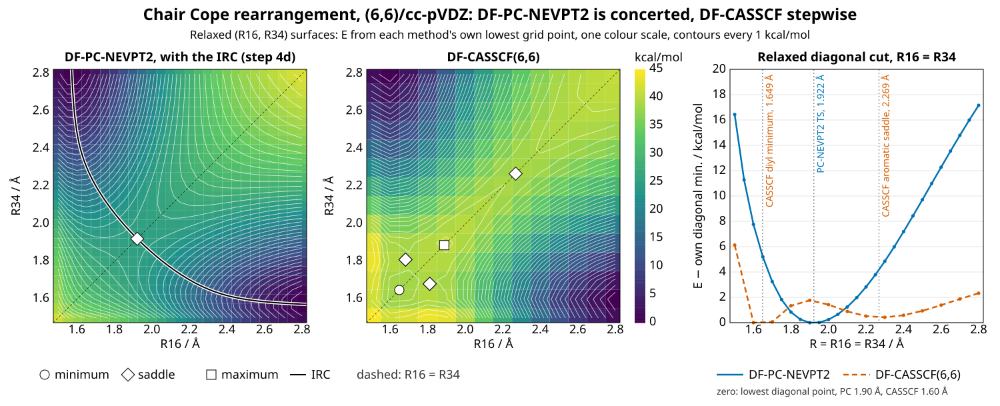
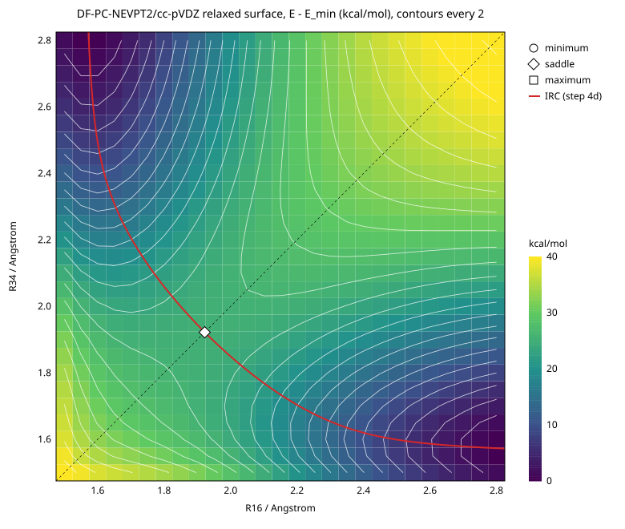
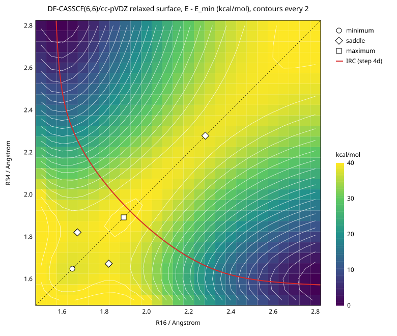

# `cope_rearrangement/step_3/`

Step 3 of the chair Cope study: the relaxed 2D (R16, R34) surface, at
DF-PC-NEVPT2 and, for the contrast, DF-CASSCF(6,6), both cc-pVDZ /
cc-pVDZ-JKFIT. Each grid point holds R16 (C1–C6) and R34 (C3–C4) fixed and
relaxes everything else. It is free-breakfast's `[optimize]` with
`constraints` (#1260) over the PC-NEVPT2 or CASSCF gradient. The study
README's "Step 3, after step 4" has why.



Left and middle: the two relaxed surfaces on one colour scale, each from its
own lowest grid point, with contours every 1 kcal/mol: PC-NEVPT2 has a
single saddle on the diagonal, which step 4d's IRC crosses, and CASSCF a
diyl well ringed by two off-diagonal saddles, a maximum and the aromatic
saddle. Right: the diagonal E(R, R), each from its own lowest diagonal grid
point, has one minimum at PC-NEVPT2 (the TS, a maximum across the diagonal)
and at CASSCF two, the diyl and the aromatic saddle, with a barrier between.

**`surface.html`** is the same figure made interactive: open it in a
browser and point at either surface or the diagonal cut to see that grid
point's converged geometry, ΔE, evaluations and active natural occupations.
The stationary-point markers show step 4b's optimised geometry where 4b
located that point (the PC TS, the CASSCF diyl and aromatic saddle), and the
nearest grid point's otherwise.

**Result.** The two surfaces have the shapes the study predicted.

- **PC-NEVPT2 has one stationary point in the whole region:** a saddle on
  the diagonal at R16 = R34 = 1.922 Å, step 4b's TS.
  - The grid fit puts it within 1e-3 Å and 0.002 kcal/mol of 4b's
    optimised TS (1.9223 Å, −233.7919655 Eh).
  - Along the diagonal E falls monotonically from 1.50 Å to it and rises
    after. There is no diyl well: the diagonal at 1.65 Å is 5.2 kcal/mol
    above the TS.
  - Its curvatures: −114 kcal/mol/Ų across the diagonal (R16 − R34), +54
    along it.
- **CASSCF(6,6) is stepwise.** It has:
  - a diyl **minimum** on the diagonal at 1.649 Å (4b: 1.642), 0.009
    kcal/mol from 4b's energy;
  - two mirror-image **saddles** off the diagonal at (1.673, 1.821) Å,
    flanking the well, 1.07 kcal/mol above 4b's diyl energy;
  - a **maximum** on the diagonal at 1.89 Å;
  - the "aromatic" a_u **saddle** on the diagonal at 2.279 Å (4b: 2.284),
    0.003 kcal/mol from 4b's.
- **The IRC lies along the PC surface's valley.** Step 4d's path, overlaid,
  leaves the saddle across the diagonal. At every one of its 97 points in
  the grid, the relaxed surface interpolated to the path's (R16, R34) is
  below the IRC's energy, as a minimum over everything else must be, by
  0.004–0.45 kcal/mol (median 0.24): that is the bilinear interpolation's
  error on a 0.05 Å grid, plus the relaxation of the path's other
  coordinates.
- **Every point converged:** 378 of 378 at PC and 378 of 378 at CASSCF,
  on the same 0.05 Å grid. Every point held its two distances to 1e-12 Å
  and kept C2 to ≤ 1.6e-4 bohr. The diagonal points also kept the
  inversion, to ≤ 2.6e-5 bohr.
- **The surfaces do not depend on the sweep's path,** but each point is
  only as converged as Gaussian's default thresholds make it. The 105
  CASSCF points shared with the earlier 0.1 Å grid, reached this time from
  neighbours half as far away, agree with it to ≤ 6.1e-5 Eh (0.038
  kcal/mol), median 9.4e-6. Re-converged at Opt=Tight from both runs'
  endpoints, the six worst land on one constrained minimum to ≤ 1.2e-8 Eh:
  no point found a second basin ("Path dependence", below).




## Method

| | |
|---|---|
| level | DF-CASSCF(6,6), and DF-PC-NEVPT2 on it; cc-pVDZ / cc-pVDZ-JKFIT, no frozen core; `conv_tol` 1e-12, `conv_tol_grad` 1e-9 (step 4b's walk settings) |
| grid | R16, R34 ∈ 1.50–2.80 Å at 0.05 Å (27 × 27), the same for both methods |
| symmetry of the grid | E(R16, R34) = E(R34, R16): the chair's inversion swaps the two bonds. So only R16 ≤ R34 is run (378 points per method) and the rest is the mirror |
| each point | `[optimize]` with `constraints = [{ atoms = [0, 5], distance = R16 }, { atoms = [2, 3], distance = R34 }]`, Gaussian's default thresholds (max force 4.5e-4, rms force 3e-4 Eh/bohr, max step 1.8e-3, rms step 1.2e-3 bohr), `max_steps` 200 |
| sweep | the diagonal outward from (1.90, 1.90), the grid point nearest step 4b's TS, which starts from `step_4/geometries/pc_ts.xyz` with step 6's `ts_hessian` orbitals. Then each row from its diagonal point, (R, R + h), (R, R + 2h), … Every point starts from its neighbour's converged geometry and CASSCF orbitals; a point whose neighbour did not converge starts from the nearest converged one before it on the same line |
| symmetry of each point | none imposed. A diagonal start is C2h and an off-diagonal one C2. The gradient keeps that symmetry, and both constraints map to themselves under C2 (C1↔C6, C3↔C4), so the walks stay C2. Checked at every point (below) |

**The thresholds are Gaussian's default, not step 4b's Opt=Tight.** The
surface is read at the 0.1 kcal/mol level. At max force 4.5e-4 Eh/bohr, a
point is within ~g²/2k of its constrained minimum along any mode with
curvature k. For k ≥ 0.05 Eh/bohr² that is ≤ 2e-6 Eh, 1e-3 kcal/mol.
Softer modes, such as the torsions of the long-R region, leave more:
measured at CASSCF, up to 1.5e-4 Eh (0.09 kcal/mol) at long R34 and up to
1.6e-5 Eh on the diagonal ("Path dependence", below).

**Sizing.** Six timed points (0.1 Å hops, before the grid was fixed) took
18–43 s each, about 30 s a point. On that basis the first plan was 1.50–3.20 Å
for both grids: 630 PC points (~5 h) and 171 CASSCF points.

The R16 = 1.50 row, running out to R34 = 3.20 Å, then cost 50–115 s a point.
Its evaluations took 4.2 s against 2.3 s near the TS, with both the CASSCF
and the PC gradient slower. The card was not throttled and not shared. At
that rate the full grid projected to ~8.7 h, over the 6–8 h budget.

So after 73 points both grids were cut to 1.50–2.80 Å. The points already
run are on the new grid, by the same names and starts. The R16 = 1.50
row's points past 2.80 Å (2.85–3.20) were run but are not part of the
surface; the analysis ignores them.

CASSCF was first run coarser, at 0.1 Å (105 points, 0.83 h), since it was
the contrast and not the result. That left its diyl fit the weakest number
here: the well is stiff, its 3 × 3 fit's minimum fell at the patch edge
(offset 0.49 cell), and the fitted energy came out 0.35 kcal/mol below
4b's diyl. So all 378 points were rerun at 0.05 Å (#1322), the 105 old
ones included, so that every point starts from a 0.05 Å neighbour, as
`parent()` and the run directories say. At 2.1 s an evaluation and 11.5
evaluations a point (median), it took 2.6 h.

The range takes the diagonal from below the CASSCF diyl (1.64 Å) to well past
the CASSCF "aromatic" point (2.28 Å). It takes the off-diagonal from below
the C–C single bond (1.55 Å) to 2.8 Å, which covers the IRC's first
4.8 amu^½ bohr each side: 25 kcal/mol of its 30.7.

**The grid's stationary points** are read off a quadratic fitted by least
squares to each 3 × 3 patch. Where the fit's stationary point falls inside
the central cell, it is kept, located, and classified by the fit's Hessian:
minimum, saddle or maximum. On an analytic double well it recovers the
minima and the saddle exactly. On the grid it is as good as the grid
spacing and each point's convergence allow, so its locations are ±h/2 at
best, and its energies the fit's.

## Results

### The stationary points

From the grid fits (`surface.json`'s `grid_stationary_points`). E is the
fit's; "4b" is step 4b's optimised stationary point at the same level.

| level | kind | R16 / Å | R34 / Å | E / Eh | against 4b | curvatures / kcal mol⁻¹ Å⁻² |
|---|---|---:|---:|---:|---|---|
| PC-NEVPT2 | saddle | 1.922 | 1.922 | −233.7919625 | TS: +2.9e-6 Eh (0.002 kcal/mol), ΔR < 1e-3 Å | −114, +54 |
| CASSCF | minimum | 1.649 | 1.649 | −232.9967033 | diyl: +1.4e-5 Eh (+0.009 kcal/mol), ΔR +0.007 Å | +165, +246 |
| CASSCF | saddle ×2 | 1.673 | 1.821 | −232.9950064 | (not located in 4b) | −147, +212 |
| CASSCF | maximum | 1.892 | 1.892 | −232.9932825 | | −298, −40 |
| CASSCF | saddle | 2.279 | 2.279 | −232.9954499 | aromatic: −5.4e-6 Eh (−0.003 kcal/mol), ΔR −0.005 Å | −263, +14 |

- **The PC saddle is the TS to the grid fit's precision**: 0.05 Å spacing,
  and a quadratic that reproduces a smooth saddle.
- **The CASSCF fits now match 4b as well.** At 0.05 Å the diyl's fitted
  minimum lies near its patch's centre (offset 0.03 cell), and its energy
  is 1.4e-5 Eh (0.009 kcal/mol) from 4b's, down from −0.35 kcal/mol at
  0.1 Å. That is the size of a diagonal point's own convergence error at
  default thresholds (up to 1.6e-5 Eh, below), so it is as close as this
  grid can get. The 0.1 Å patch had also overestimated the well's
  stiffness: +165 and +246 kcal/mol/Ų, not +309 and +389. The aromatic
  saddle is 0.003 kcal/mol and 0.005 Å from 4b's.
- **The off-diagonal saddles' fits are the least central**: offsets 0.46
  and 0.43 cell in their patch, so their location is good to about h/2,
  0.025 Å. They sit 1.07 kcal/mol above 4b's diyl, as at 0.1 Å (1.1).
- **The CASSCF stepwise route** is hexadiene → off-diagonal saddle → diyl →
  mirror saddle → hexadiene. Its saddles are 1.07 kcal/mol above 4b's exact
  diyl, so the diyl is a shallow intermediate. The aromatic saddle, 0.80
  kcal/mol above the diyl in 4b, is a second, symmetric route over the
  diagonal. The maximum between the two diagonal stationary points is what
  separates them.

### The diagonal, E(R, R)

ΔE in kcal/mol from each grid's lowest point, which is on its edge
(PC (1.55, 2.80), CASSCF (1.60, 2.80)) and not a stationary point. Only the
shape along R is meant.

| R / Å | 1.50 | 1.60 | 1.65 | 1.70 | 1.80 | 1.90 | 1.95 | 2.00 | 2.10 | 2.20 | 2.30 | 2.40 | 2.60 | 2.80 |
|---|---:|---:|---:|---:|---:|---:|---:|---:|---:|---:|---:|---:|---:|---:|
| PC | 41.78 | 33.10 | 30.54 | 28.59 | 26.18 | **25.34** | 25.36 | 25.58 | 26.59 | 28.17 | 30.19 | 32.53 | 37.62 | 42.50 |
| CASSCF | 44.70 | 38.57 | **38.19** | 38.62 | 39.90 | 40.33 | 40.21 | 39.98 | 39.45 | 39.07 | **38.98** | 39.14 | 39.94 | 40.90 |

PC has one minimum on the diagonal, which is the saddle across it. CASSCF
has two, the diyl near 1.65 and the aromatic point near 2.3, with a maximum
between them.

### The reference wavefunction on the diagonal

Active natural occupations from each point's CASSCF. For the PC grid that
is the CASSCF the PC-NEVPT2 rests on, at the PC-relaxed geometry.

| R / Å | PC grid: n3 / n4 | CASSCF grid: n3 / n4 |
|---|---|---|
| 1.60 | 1.432 / 0.568 | 1.377 / 0.623 |
| 1.65 | 1.527 / 0.474 | 1.455 / 0.545 |
| 1.90 | 1.810 / 0.192 | 1.790 / 0.212 |
| 2.30 | 1.841 / 0.159 (n5 0.111) | 1.845 / 0.156 (n5 0.112) |

**The diradical pair opens near 1.6 Å on both surfaces.** On the PC grid's
reference it reaches 1.43 / 0.57. What differs is the energy: CASSCF puts a
minimum there and PC-NEVPT2 does not. The dynamic correlation, not a
different reference, removes the diyl, which is the study's premise.

### Convergence and cost

| | points | converged | evaluations, median / max | wall per point, median / max | total | max C2-breaking / bohr |
|---|---:|---:|---|---|---:|---:|
| PC | 378 | 378 | 11 / 36 | 37 s / 123 s | 4.28 h | 1.5e-4 |
| CASSCF | 378 | 378 | 11.5 / 27 | 22.5 s / 64 s | 2.57 h | 1.6e-4 |

Plus, at PC, the R16 = 1.50 row's eight points past 2.80 Å, 0.2 h, from
before the grid was cut, and at CASSCF the superseded 0.1 Å grid, 0.83 h.
No point failed, so none started from anything but its direct neighbour.

### Path dependence

The 105 CASSCF points on the old 0.1 Å grid were each run twice: once in
the 0.1 Å sweep, from a neighbour 0.1 Å away (the committed
`surface_casscf.csv` before #1322), and once in this one, from a neighbour
0.05 Å away. Both are the same constrained minimum, so they differ only
by where each walk stopped.

| | |
|---|---|
| max \|ΔE\| | 6.1e-5 Eh (0.038 kcal/mol), at (1.80, 2.80) |
| median \|ΔE\| | 9.4e-6 Eh |
| mean ΔE (new − old) | −3.1e-6 Eh; new lower at 29 of the 52 points over 1e-5 |
| points over 1e-5 Eh | 52 of 105: 44 off the diagonal, mostly R34 ≥ 2.3 Å, and 8 on it |
| points over 1e-4 Eh | none |
| max geometry RMSD (Kabsch) | 0.043 bohr |
| max active-occupation change | 1.7e-3 |

**That is more than the ~1e-6 Eh expected, and it is convergence, not a
second basin.** The sign is mixed, so neither sweep sits systematically
lower, and the geometries differ along soft modes by up to 0.04 bohr. Six
points were re-converged at Opt=Tight (step 4b's thresholds) from both
runs' endpoints: the four worst, and the two diagonal ones nearest the
diyl.

| point | ΔE at default, new − old | at Opt=Tight, new − old | geometry RMSD at Opt=Tight / bohr | default above tight: new, old |
|---|---:|---:|---:|---|
| (1.80, 2.80) | −6.1e-5 | +2.8e-9 | 1.8e-4 | 2.1e-5, 8.2e-5 |
| (2.00, 2.80) | −6.0e-5 | +3.3e-9 | 1.6e-4 | 8.5e-5, 1.5e-4 |
| (1.80, 2.60) | +5.3e-5 | +1.6e-9 | 1.6e-4 | 7.2e-5, 1.9e-5 |
| (1.60, 2.40) | −4.6e-5 | −1.8e-9 | 1.9e-4 | 6.2e-6, 5.3e-5 |
| (1.50, 1.50) | +1.6e-5 | −1.2e-8 | 3.9e-4 | 1.6e-5, 2.0e-7 |
| (1.60, 1.60) | +1.4e-5 | −5.3e-10 | 6.0e-5 | 1.5e-5, 1.0e-6 |

Energies in Eh. Each pair reaches one minimum, to ≤ 1.2e-8 Eh and ≤ 4e-4
bohr. Every default-threshold point is above it, by up to 1.5e-4 Eh (0.09
kcal/mol) in the long-R34 region and up to 1.6e-5 Eh on the diagonal near
the diyl. Gaussian's default thresholds stop on the step and the force,
and along a mode as soft as these a point can meet both well short of the
minimum. The other 46 points over 1e-5 Eh are the same kind (same region,
mixed sign, ≤ 0.04 bohr) and were not re-converged. The PC surface uses
the same thresholds, and its scatter has not been measured this way.

## Files

| File | What |
|---|---|
| `surface.py` | `run METHOD [NAME ...]` (prepare and run each point in sweep order, from its neighbour; skips one done), `names METHOD` (the sweep order), `analyse` → `surface.json`, `surface_<method>.csv`, `geometries_<method>.xyz`, `surface_<method>.svg`, `comparison.svg`, `surface.html` |
| `surface.py comparison` | `comparison.svg` alone, from the committed `surface_<method>.csv`, `surface.json` and `step_4/irc.csv` (no runs needed; `analyse` also writes it) |
| `surface.py interactive` | `surface.html` alone, from the committed files (no runs needed; `analyse` also writes it) |
| `contour.py` | the contour plots, stdlib SVG (matplotlib is not in `uv.lock`; step 2's plot is the precedent) |
| `page.py`, `page.html.in` | `surface.html`'s data (from `surface_<method>.csv`, `surface.json`, `geometries_<method>.xyz`, and step 4's `irc.csv`, `stationary.json` and `geometries/`) and the page it goes into. Edit the `.in`, not the `.html` |
| `run.sh` | `surface.py run` holding the CUDA card, as step 4's and step 6's |
| `surface.json` | settings; per method the run status, the points that did not converge, the grid's stationary points, the diagonal E(R), and totals |
| `surface_<method>.csv` | every point of the full square (the mirrored half marked `mirrored = 1`): status, E, ΔE from the grid minimum (kcal/mol), evaluations, max force, wall clock, the final distances, the C2-breaking measure, the six natural occupations |
| `surface_<method>.svg` | the contour plot, the IRC (step 4d) overlaid on the PC one |
| `comparison.svg` | both surfaces on one colour scale and contour interval (1 kcal/mol), the IRC on the PC one, and the diagonal cut E(R, R) of both |
| `geometries_<method>.xyz` | every run point's converged geometry (378 frames per method, R16 ≤ R34), in sweep order, the atom lines verbatim from its `final.xyz`; each comment line names the point and gives R16, R34 and E. Molden and IboView read it as a trajectory |
| `surface.html` | the interactive page: both surfaces, the diagonal cut, and the geometry of whichever point is under the cursor. Self-contained apart from its web fonts, which fall back to system ones offline |

`inputs/` and `runs/` are gitignored. `geometries_<method>.xyz` keeps each
point's final geometry, but not its orbitals, CI vector or optimisation
path, which only `runs/` has.

### Regenerating

From the repo root, after step 6's `ts_hessian` (whose orbitals seed the
sweep) and step 4d's `irc.csv` (the overlay):

```sh
# run's prepare needs numpy, which the image's /opt/venv does not carry
PATH=$PWD/.venv/bin:$PATH taskset -c 0-7 experimental/cope_rearrangement/step_3/run.sh pc
PATH=$PWD/.venv/bin:$PATH taskset -c 0-7 experimental/cope_rearrangement/step_3/run.sh casscf
UV_PROJECT_ENVIRONMENT=$PWD/.venv uv run --group tools \
    python experimental/cope_rearrangement/step_3/surface.py analyse
```

`comparison.svg` alone needs only the committed files and the standard
library:

```sh
python3 experimental/cope_rearrangement/step_3/surface.py comparison
```

`surface.html` alone needs only the committed files and numpy:

```sh
UV_PROJECT_ENVIRONMENT=$PWD/.venv uv run --group tools \
    python experimental/cope_rearrangement/step_3/surface.py interactive
```
